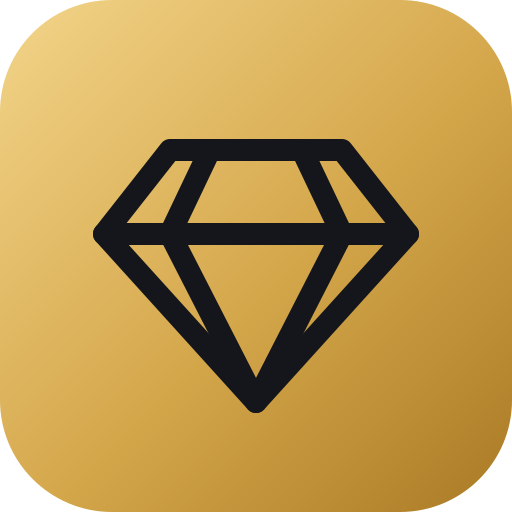
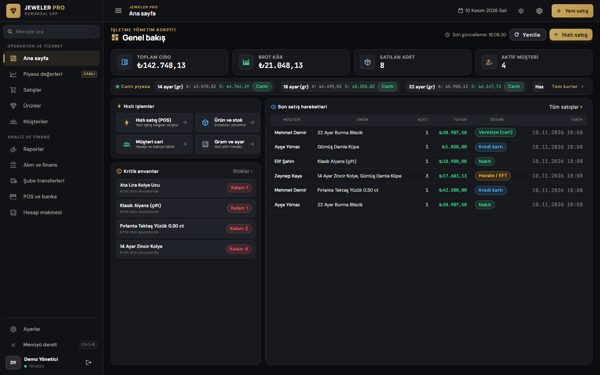
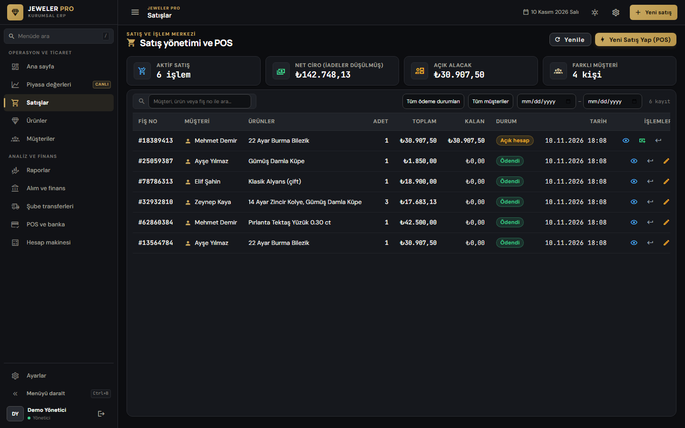
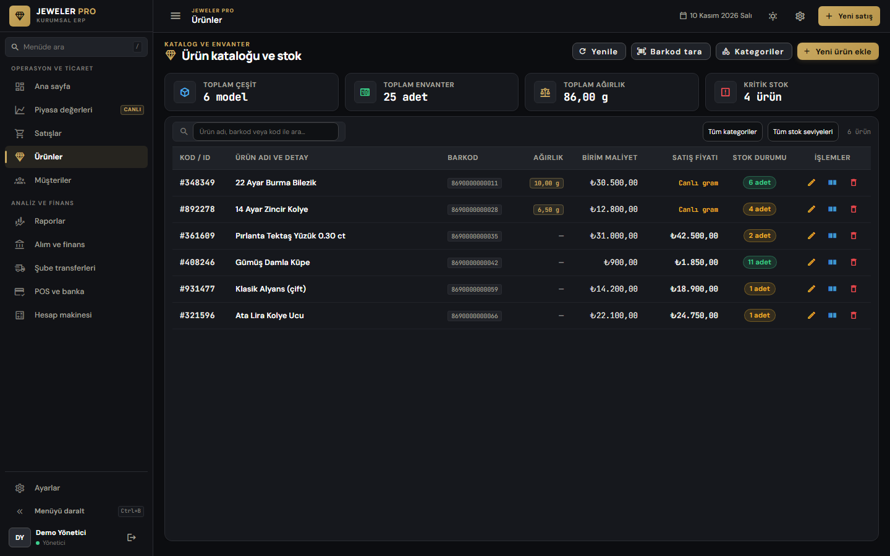
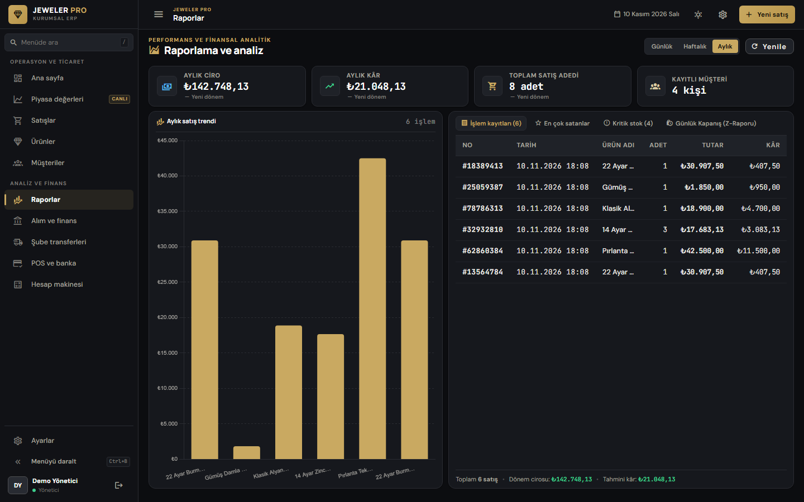
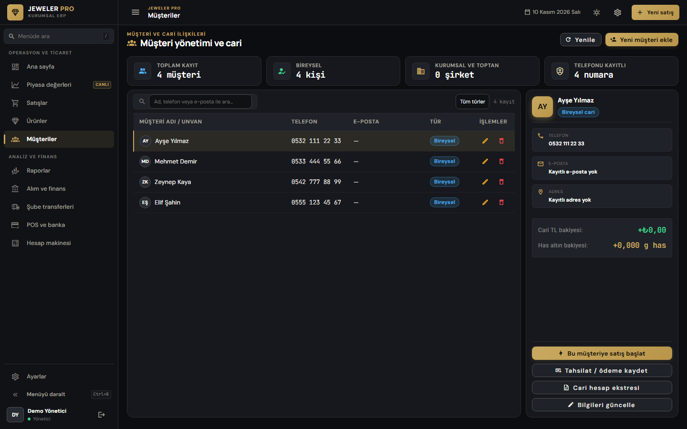
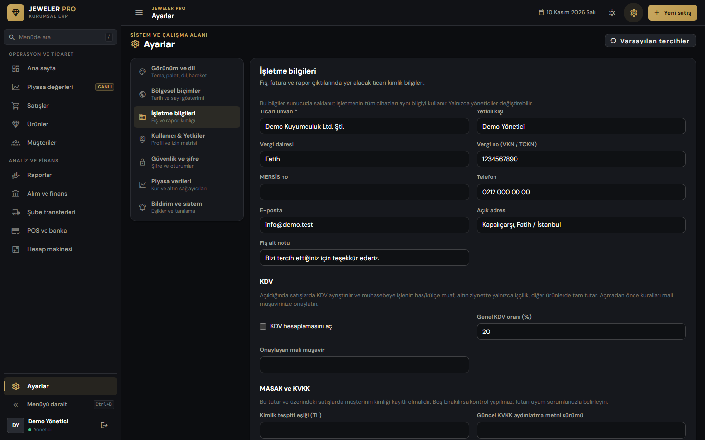
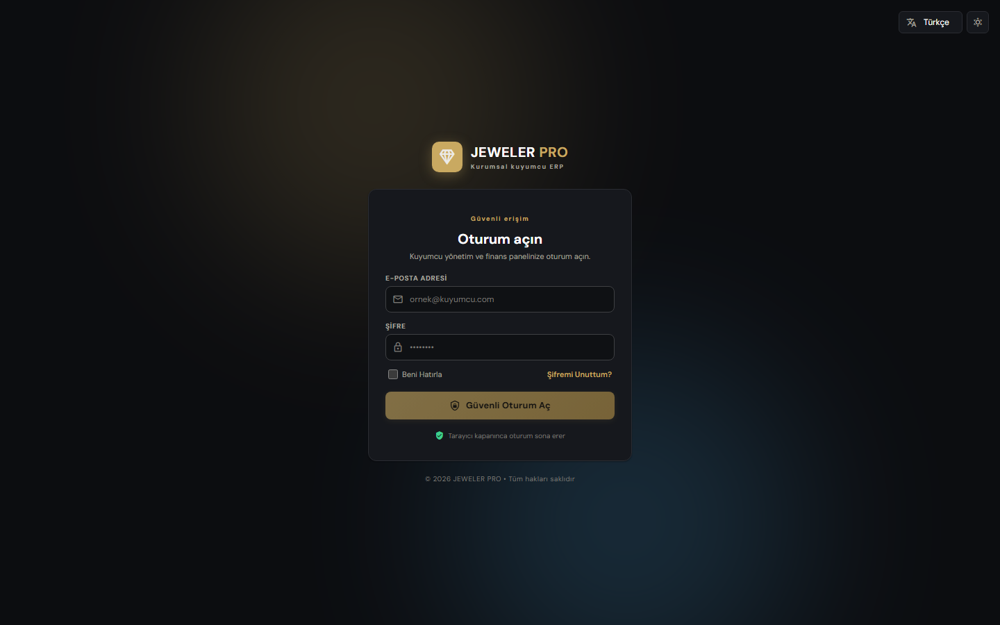
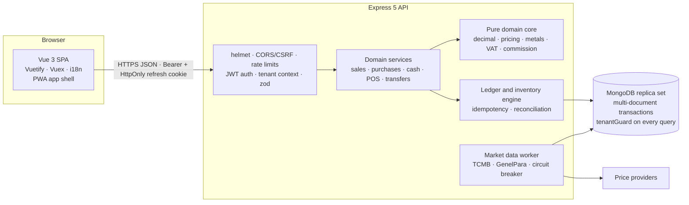

<div align="center">



# Jeweler Pro

**Point of sale, stock, gold and accounting for jewellery shops, built for the Turkish market.**

Sell by the piece or by the gram at live gold prices. Keep pieces and fine gold in one stock. Every sale is posted to a double-entry ledger in the same database transaction.

[](https://github.com/akifkeklik/jeweler-pro/actions/workflows/ci.yml)
[](LICENSE)


[Features](#features) · [Screenshots](#screenshots) · [Architecture](#architecture) · [Quick start](#quick-start) · [Engineering](#engineering-quality) · [Docs](#documentation) · [Roadmap](docs/ROADMAP.md)

<br />



</div>

---

## Why

A jewellery shop isn't a generic retail store:

- A 22-karat bracelet's price changes every few minutes with the gold market.
- Labour (*işçilik*) is quoted in per-mille, per gram or as a fixed amount.
- Customers pay in cash, by card (with POS commission and settlement days) or on account.
- In Turkey, VAT on gold jewellery is charged on the margin above the gold value.

Jeweler Pro models these rules explicitly instead of approximating them. Money is stored in integer kuruş, weights in milligrams and purity in parts per 10,000. All arithmetic uses BigInt, and nothing financial ever touches floating point.

## Features

| | |
|---|---|
| **Sales and POS** | Multi-line carts, line and basket discounts, split payments (cash, card, transfer, on account), returns and cancellation. Barcode scanning at the till. Printable 80 mm sales slips |
| **Gold-aware pricing** | Gram pricing from the live has-gold quote: `weight × (purity + labour‰) × price`, or per-gram or fixed labour. Prices older than 5 minutes are refused, and the user enters a manual price instead |
| **Stock** | Pieces and fine-gold pools per branch, conditional stock writes (no overselling under concurrency), inter-branch transfers with approval and reservation, Code 128 labels |
| **Accounting** | Double-entry ledger, cash and card tills, POS commission and bank settlement, customer and supplier accounts, daily Z report, full reconciliation endpoint |
| **Purchases** | Supplier invoices, payments and refunds, purchase returns at historical cost |
| **Turkish compliance** | KDV engine (bullion exempt, margin basis on gold jewellery, full price otherwise) behind an accountant-approval switch. MASAK identification threshold. KVKK identity masking, privacy-notice record and erasure |
| **Market data** | TCMB and GenelPara providers with circuit breakers, live-over-stale failover and quota awareness |
| **Multi-business** | Tenant isolation enforced at the data layer: an unscoped query throws instead of leaking |
| **Access control** | Roles plus fine-grained permissions, revocable device sessions, audit trail |
| **Eight languages** | TR, EN, DE, FR, ES, RU, AR (right-to-left), ZH. Nine colour palettes, light and dark |

## Screenshots

<table>
  <tr>
    <td width="50%"><p align="center"><sub><b>Sales and POS</b>: payment status, open balances, returns</sub></p></td>
    <td width="50%"><p align="center"><sub><b>Catalogue</b>: gram-priced and fixed-price items, barcodes, stock levels</sub></p></td>
  </tr>
  <tr>
    <td><p align="center"><sub><b>Reports</b>: turnover, profit at cost, top sellers, Z report</sub></p></td>
    <td><p align="center"><sub><b>Customer accounts</b>: balances in TRY and gold</sub></p></td>
  </tr>
  <tr>
    <td><p align="center"><sub><b>Business profile</b>: legal identity, KDV, MASAK and KVKK</sub></p></td>
    <td><p align="center"><sub><b>Sign in</b>: remember-me sessions, password reset</sub></p></td>
  </tr>
</table>

<sub>Screenshots use generated demo data and are reproducible with `npm run screenshots`.</sub>

## Architecture



**Key design decisions**

- **One transaction per business event.** A sale moves stock, posts the journal (revenue, KDV, COGS, inventory), records payments and card captures, and writes the audit entry atomically. A retried request with the same `Idempotency-Key` is applied once.
- **Pure domain core.** `backend/domain/*` has no I/O and is tested with hand-computed figures. Services orchestrate it.
- **Fail closed.** No live price means no automatic sale. No tenant means no access. Unsafe production configuration means the server does not start.
- **Documented assumptions.** Every rule with legal or accounting impact is listed in [BUSINESS_RULES.md](backend/BUSINESS_RULES.md) and marked for professional validation.

## Tech stack

| Layer | Technology |
|---|---|
| Frontend | Vue 3, TypeScript, Vuetify 3, Vuex 4, Vue Router 4, Chart.js, Vite 6, vite-plugin-pwa |
| Backend | Node.js ≥ 22, Express 5, Mongoose 8, jsonwebtoken, helmet, zod, nodemailer |
| Database | MongoDB 7 replica set (transactions required) |
| Testing | Node test runner + mongodb-memory-server, Vitest + Vue Test Utils, Playwright |
| Tooling | ESLint, Prettier, vue-tsc, GitHub Actions, Dependabot, Docker |

## Quick start

### With Docker (whole stack)

```bash
cp backend/.env.example backend/.env    # set JWT_SECRET, ADMIN_EMAIL, ADMIN_PASSWORD
docker compose --profile app up -d --build
```

Open <http://localhost:8080> and sign in with the administrator from `backend/.env`. The API runs on <http://localhost:5000> (`/health/ready`).

### Local development

Requirements: Node.js 22.12+ (24 LTS recommended) and Docker for MongoDB.

```bash
docker compose up -d mongo              # single-node replica set rs0

cd backend
npm ci
cp .env.example .env                    # JWT_SECRET (≥ 32 chars), ADMIN_EMAIL, ADMIN_PASSWORD (≥ 14 chars)
npm run dev                             # http://localhost:5000

cd ..
npm ci
cp .env.example .env                    # VITE_API_URL=http://localhost:5000
npm run dev                             # http://localhost:8080
```

<details>
<summary><b>Windows (PowerShell) and troubleshooting</b></summary>

- Use `Copy-Item .env.example .env` instead of `cp`.
- Generate a secret with `node -e "console.log(require('crypto').randomBytes(48).toString('hex'))"`.
- If port 5000 is taken, set `PORT=5001` in `backend/.env` and `VITE_API_URL=http://localhost:5001` in `.env`, then restart both.
- The frontend origin must be listed in `CORS_ORIGIN` (default `http://localhost:8080`).
- `Invoke-RestMethod http://localhost:5000/health/ready` should report `database: connected`.

</details>

### First steps in the app

1. **Settings → Business:** enter the company name, tax office and tax number. They appear on every receipt.
2. Leave **KDV** off until your accountant has approved the rules. Switching it on requires the approver's name.
3. Set the **MASAK identification threshold** with your compliance officer. No legal default is shipped.

## Engineering quality

| Gate | What it checks |
|---|---|
| **637 automated tests** | 419 backend (real MongoDB replica set, HTTP end to end) and 218 frontend |
| **Tenant isolation** | `tenantGuard` rejects any business-data query without `businessId`. Cross-tenant HTTP tests |
| **Financial correctness** | Hand-computed expected figures, reconciliation after every workflow, concurrency tests for overselling |
| **API contract** | [`docs/openapi.json`](docs/openapi.json) covers all 115 operations. A test fails if code and contract drift |
| **Static analysis** | ESLint (0 errors), `vue-tsc`, locale completeness in all 8 languages |
| **Supply chain** | `npm audit` (no high-severity runtime advisories), Dependabot, versioned base images |
| **Delivery** | Multi-stage, non-root Docker images with health checks, JSON logs in production, optional error webhook |

```bash
npm run lint && npm run typecheck && npm test && npm run build   # frontend + lint for both
npm --prefix backend test                                        # backend, throw-away replica set
```

CI runs all of the above, plus the dependency audit and both Docker builds, on every push and pull request.

## Project structure

```text
├── backend/
│   ├── domain/            # pure money, metal, pricing, VAT and commission rules (no I/O)
│   ├── services/          # sales, purchases, cash, POS, transfers, catalogue, fiscal seam
│   │   └── finance/       # ledger, inventory, idempotency, tenant context
│   ├── models/            # Mongoose schemas (+ plugins/tenantGuard.js)
│   ├── routes/            # HTTP layer
│   ├── middleware/        # auth, permissions, CSRF, rate limits, validation, errors
│   ├── providers/         # market-data providers with circuit breakers
│   ├── scripts/           # migrations, bootstrap, route listing
│   └── test/              # node:test suites (unit + HTTP integration)
├── src/
│   ├── pages/             # screens (sales, products, customers, reports, …)
│   ├── components/        # shared UI
│   ├── services/          # API client, auth session, barcode, receipt, printing
│   ├── i18n/              # 8-language message source and compiled catalogues
│   └── theme/             # palettes and design tokens
├── tests/                 # Vitest specs and Playwright e2e / visual QA
├── docs/                  # OpenAPI, ADRs, fiscal integration, roadmap, screenshots
└── deploy/                # nginx config for the web image
```

## Documentation

| Document | Content |
|---|---|
| [BUSINESS_RULES.md](backend/BUSINESS_RULES.md) | Precision, metals, pricing, ledger, inventory, POS, VAT, MASAK, KVKK, plus assumptions to validate |
| [SECURITY.md](backend/SECURITY.md) | Sessions, tokens, CSRF, rate limiting, audit and data minimisation |
| [OPERATIONS.md](backend/OPERATIONS.md) | Backups, migrations with dry run, production checklist |
| [openapi.json](docs/openapi.json) | API contract |
| [FISCAL_INTEGRATION.md](docs/FISCAL_INTEGRATION.md) | Plan for e-Arşiv / e-Fatura / ÖKC integration |
| [ADR 0001](docs/adr/0001-branch-identity.md) | Branch identity decision |
| [ROADMAP.md](docs/ROADMAP.md) | What is next, and what is blocked on whom |
| [CONTRIBUTING.md](CONTRIBUTING.md) | PR size, commits, rules for AI-assisted code |

## Status

Jeweler Pro is a complete, tested application, but it is **not a certified fiscal or accounting system**. Legal invoices (e-Arşiv, ÖKC) are issued outside the app until an integrator is connected, and the KDV, MASAK and KVKK behaviour implements documented assumptions that need professional approval. See the [roadmap](docs/ROADMAP.md).

## License

[MIT](LICENSE) © 2026 Akif Keklik
